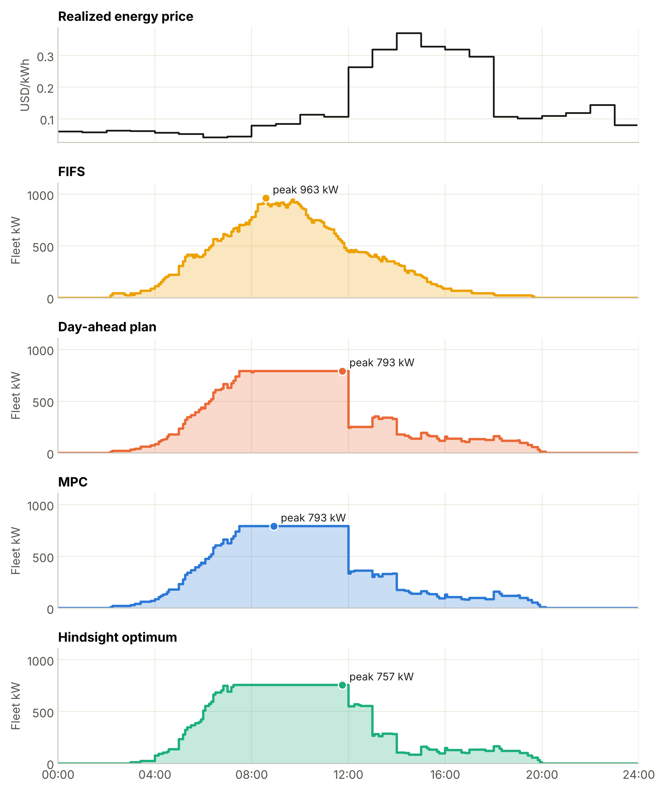

# evopt: modular EV fleet charging optimization

Simulates one day at a shared charging site and schedules every EV's charging power
per time slot. The schedule minimizes expected energy cost plus optional terms:

- a **demand charge** on the day's peak fleet power,
- an **overcurrent limit**: a hard constraint `p[i,t] <= p_safe` on each EV's charging power,
- an **expected-shortfall penalty** (or chance constraint) for uncertain demand: each EV's requested energy is a Gaussian random variable (an optional `price_risk` term for uncertain prices is still available).

Sessions are known a day ahead, but each EV's energy demand is only a Gaussian
`Normal(energy_requested, sd^2)` with `sd = cv * energy_requested`. Prices are treated as known by
default. The true demand is drawn per simulated day (an EV stops charging when full), and the MPC
loop re-plans as EVs plug in and their true demand is revealed. Results are compared with a
First-In-First-Served (FIFS) baseline and with the hindsight optimum.



## Install

```bash
conda env create -f environment.yml
conda activate evopt
pytest                      # 12 tests, a few seconds
```

## Run

```bash
python scripts/run_experiment.py configs/experiments/smoke.yaml          # ~5 s
python scripts/run_experiment.py configs/base.yaml                       # ~3 min
python scripts/run_experiment.py configs/experiments/ablation.yaml       # which term does what
python scripts/run_experiment.py configs/experiments/risk_frontier.yaml  # expected shortfall vs chance constraints
python scripts/run_experiment.py configs/experiments/demand_uncertainty.yaml  # sweep of demand sd
```

Each run writes `results/<name>/`: `metrics.csv` (one row per variant, scenario, price
day and method), `summary.csv`, the schedules of one example day, and figures as PDF and PNG.

## How it fits together

```
config (YAML)
   |
data/      sessions (synthetic | csv | acn)  +  demand uncertainty  +  price model
   |
model/     base constraints + the terms listed in the config  ->  cvxpy problem
   |
sim/       day-ahead plan, MPC re-planning, hindsight optimum;  baselines/ FIFS
   |
metrics.py one evaluator scores every schedule under the realized prices
   |
viz/       figures from the saved results
```

| Folder | What is in it |
| --- | --- |
| `src/evopt/data/` | `schema.py` (the session table), one file per data source, `prices.py` |
| `src/evopt/model/` | `problem.py` (variables and base constraints), `terms/` (one file per objective term) |
| `src/evopt/baselines/` | `base.py` (interfaces), `fifs.py` |
| `src/evopt/sim/` | `plan.py`, `mpc.py`, `runner.py` |
| `src/evopt/metrics.py` | the shared evaluator |
| `src/evopt/viz/` | style and plotting functions |
| `configs/` | `base.yaml` and one file per experiment |

## The model

Variables: charging power `p[i,t]` (kW) and expected unmet energy `e[i]` (kWh).
Demand of EV `i` is `R[i] ~ Normal(mu[i], sd[i]^2)`; `d[i] = dt * sum_t p[i,t]` is what the plan delivers.
Fleet power is `P[t] = sum_i p[i,t]`; slots last `dt` hours.

Always on (problem (1) of Calafiore et al., ECC 2025):

```
0 <= p[i,t] <= max_rate[i]   while EV i is plugged in, else 0
d[i] <= mu[i] + 3 sd[i]
P[t] <= site capacity
```

Objective terms, each switched on by a line under `model.terms` in the config:

| Term | Cost added | Reference |
| --- | --- | --- |
| `energy_cost` | `dt * sum_t mean_price[t] * P[t]` | Calafiore et al. |
| `unmet_energy` | `gamma * sum_i e[i]`, with `e[i] >= E[(R[i] - d[i])+]` (`mode: expected`, piecewise-linear tangents of the Gaussian expected shortfall) or `e[i] >= mu[i] + z_(1-eps) sd[i] - d[i]` (`mode: quantile`, chance constraint) | Calafiore et al.; B&V 4.4 |
| `demand_charge` | `alpha * s`, with `s >= P[t]` for all t | epigraph form, Boyd & Vandenberghe 4.1.3 |
| `current_limit` | none (constraint `p[i,t] <= p_safe[i]`) | overcurrent limit |
| `price_risk` | `kappa * dt^2 * P' Sigma P` (variance of the bill) | LP with random cost, B&V 4.4.1 |
| `equal_sharing` | `eps * sum p[i,t]^2` (makes the schedule unique) | Lee et al. (ACN) |

**MPC.** At each re-plan time the power already delivered is fixed, every EV that has plugged in
reveals its true demand (`sd` becomes 0 for it), the price forecast is updated if prices are
uncertain, and the same problem is solved for the remaining slots. A peak that has already happened stays in the demand charge.

## Adding or removing a module

Removing a term, baseline or method is deleting its line in the YAML config.
Adding one is a single new file; it is picked up automatically.

A new objective term, `src/evopt/model/terms/my_term.py`:

```python
import cvxpy as cp
from evopt.model.terms.base import Term
from evopt.registry import TERMS

@TERMS.register("ramp_limit")
class RampLimit(Term):
    def __init__(self, max_step_kw=100):
        self.max_step_kw = max_step_kw

    def build(self, ctx):                       # ctx.p, ctx.e, ctx.fleet_kw, ctx.sessions, ctx.site, ctx.prices
        steps = cp.diff(ctx.fleet_kw)
        return [cp.abs(steps) <= self.max_step_kw], 0      # (constraints, cost)
```

then `ramp_limit: {max_step_kw: 80}` under `model.terms`.

A new baseline, `src/evopt/baselines/edf.py`, then `baselines: [fifs, edf]`:

```python
from evopt.baselines.base import PriorityGreedy
from evopt.registry import BASELINES

@BASELINES.register("edf")
class EDF(PriorityGreedy):
    def priority(self, ev, t, remaining_kwh):
        return ev.departure
```

A new data source: a class with `load(site, rng)` that returns the session table
described in `data/schema.py`, decorated with `@SOURCES.register("name")`.

## Parameters: sourced vs assumed

| Parameter | Default | Status |
| --- | --- | --- |
| Slot length, horizon | 5 min, 24 h | Sourced (Calafiore et al.) |
| Sessions per day, arrival, dwell, request | 100, Beta(5.52, 12), Normal(6 h, 1 h), Uniform share of the maximum | Sourced (Calafiore et al.) |
| EV max rate, site capacity | 22 kW, 1.13 MW | Sourced (Calafiore et al.) |
| Demand charge | 15.51 USD/kW/month (SCE TOU EV-4, 2017) | Sourced (Lee et al.); prorating by 30 days is assumed |
| Price history | TOU shape with AR(1) lognormal noise | **Placeholder**, replace with real prices (`prices.source: csv`) |
| Demand uncertainty `cv` (sd / mean request) | 0.2 | Assumed, sweep it (`demand_uncertainty` experiment) |
| Gaussian price model | only used if `prices.params.volatility > 0` | Assumed |
| `gamma` (unmet energy) | 1.0 USD/kWh | Assumed |
| `kappa` (price-risk term, off by default) | 0.01 per USD | Assumed |
| Safe power `p_safe_kw` (overcurrent limit) | 5 kW | Assumed |
| `eps` (equal sharing) | 1e-7 | Assumed |
| MPC re-plan interval | 60 min | Assumed |


## References

- G. C. Calafiore et al., "Robust Power Scheduling for Smart Charging of Electric Vehicles", ECC 2025.
- Z. J. Lee et al., "Adaptive Charging Networks: A Framework for Smart Electric Vehicle Charging", arXiv:2012.02636.
- S. Boyd and L. Vandenberghe, *Convex Optimization*, Cambridge University Press, 2004.
